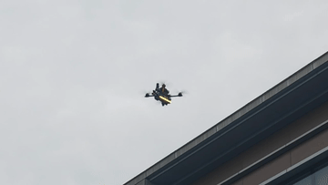
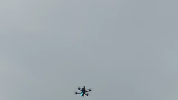
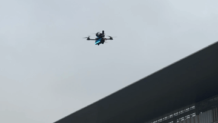

# holydrone_autotune

ROS 1 + MAVROS 的 PX4 角速度环候选参数试验包：**依次写入预设 PID 候选，施加相同角速度脉冲，记录实际响应，再离线比较各组指标。**
当前不拟合一阶模型，不自动生成新候选、排名或写回最优参数；下一轮参数由操作者决定。

```text
候选 YAML → 写入 PX4 并读回确认 → 人工进入 OFFBOARD → 逐候选 low/high 脉冲
  → ROS 事件 + PX4 ULog → 时间对齐与分段 → 跟踪指标、汇总表和曲线
```

核心实现：[在线状态机](src/brct_autotune_fsm.cpp)、[离线分析与指标计算](scripts/autotune_analyze.py)。一阶响应及物理参数辨识属于另一个包 `holydrone_identification`。

## 实机演示

三个轴的调参动作如下。点击动态预览可打开对应的完整 MP4 视频（1280 × 720，含原声）。

| Roll（横滚） | Pitch（俯仰） | Yaw（偏航） |
| :---: | :---: | :---: |
| [](media/roll.mp4) | [](media/pitch.mp4) | [](media/yaw.mp4) |

## 1. 候选参数与激励

### 试验哪些参数

当前 [brct_autotune_sim.yaml](config/brct_autotune_sim.yaml) 针对 **holydrone_lite / airframe 22001 仿真**，对 FRD roll 轴做 P/D 粗搜索：

| 候选 | P | I | D | FF | K |
| --- | --- | --- | --- | --- | --- |
| `p_0p90` | 0.0486 | 0 | 0.0014 | 0 | 1 |
| `p_1p00` | 0.0540 | 0 | 0.0014 | 0 | 1 |
| `p_1p10` | 0.0594 | 0 | 0.0014 | 0 | 1 |

旧候选 P=0.135～0.165、D=0.003 在 lite 模型中产生约 10 Hz 持续 roll 振荡；仅退回 P≈0.08、D=0.001 仍存在明显阶跃振铃，因此最终搜索中心改为 P=0.054、D=0.0014，并同步更新 lite airframe 的默认 roll 增益。恢复 baseline 使用 P/I/D=0.054/0.074/0.0014，PD 试验候选仍将 I 置零。这些参数不代表其他机型或实机已验证。

这些是预先指定的 PX4 参数，不是辨识结果。`axis` 可选 roll/pitch/yaw，每组必须提供对应轴完整的 P/I/D/FF/K。
`search_stage: pd` 要求 I=FF=0，K 固定为 baseline K；`manual` 允许非零 I/FF，但仍固定 K。
`baseline` 是人工填写的恢复值，不是启动时自动备份的飞控参数。

连接后预加载第一候选。通过 MAVROS 的 `/mavlink/to`、`/mavlink/from` 定向读取该轴 P/I/D/FF/K，
只写变化项，逐项等待飞控 `PARAM_VALUE` 确认，再定向读取全部五项复核。
不调用全量参数拉取或用缓存确认成功；每项请求等待 1 s、最多尝试 3 次。
检查回复来源、参数名称、REAL32 类型及有限数值，拒绝请求前的带时间戳回复。
目标 IDs 使用 MAVROS 的 `target_system_id` / `target_component_id`，多实例可 remap 原始 MAVLink 话题。满足下式才视为成功：

$$
|p_{\mathrm{read}}-p_{\mathrm{target}}|\le 10^{-7}+10^{-5}|p_{\mathrm{target}}|
$$

事务在后台运行，参数回复由独立回调队列和线程处理，避免与 200 Hz 控制、IMU 和日志回调争用。
超时会记录目标 ID、MAVROS 订阅者数、原始接收数、参数回复数及拒绝原因（来源、长度/帧、名称、旧时间戳），帮助区分链路无回复和本地过滤。
部分写入后失败会保留已生效参数，停止后续激励，不自动回滚。

### 使用什么激励

每个候选依次执行 low、high 两档；当前幅值为 60、120 deg/s（约 1.047、2.094 rad/s）。
每档开始先回中，每次 repetition 执行：

```text
+A → PX4 位置制动、回中稳定 → −A → PX4 位置制动、回中稳定
```

每个脉冲默认持续 0.25 s，每个 repetition 是两个独立脉冲；重复数由 `excitation.repetitions` 决定。
N 个候选、两档幅值、R 次重复共 4NR 个脉冲，实际总时长还包括参数事务、组间交接和回中。
脉冲期间只给所选轴非零角速度指令。roll、pitch、yaw 共用同一流程：每个脉冲后发送 0.1 s 零角速度缓冲，再切入 PX4 位置控制，主动消除水平速度并回中；不再使用只恢复水平姿态的独立等待分支。满足下方稳定条件后，才允许下一脉冲。

配置、事件和离线报告使用 FRD（前、右、下）；MAVROS 发布使用 FLU（前、左、上），pitch/yaw 发布前取反。
指令通过 `/mavros/setpoint_raw/attitude` 发送，归一化推力为正标量。应使用
`setpoint_raw/thrust_scaling: 1.0`，并确保只有一个节点发布控制设定值。

## 2. 定高、回中与试验推进

### 推力基准和定高

进入 OFFBOARD 时记录 ENU 位置和航向，先发送位置目标让 PX4 闭环悬停。
每个脉冲前，只在回中条件满足时采集 `/mavros/setpoint_raw/target_attitude.thrust`：
位置阶段开始后隔离 0.65 s，取最近 0.5 s 中至少 3 个、覆盖至少 0.2 s 的新鲜样本平均值作为该脉冲的 $T_h$。
样本间断或运动条件不满足会清空窗口；每个脉冲前重新采集并重置高度积分，不用固定值回退。

[定高控制](include/holydrone_autotune/altitude_control.hpp) 仅在角速度脉冲期间工作，位置阶段高度由 PX4 控制。设高度误差 $e_z=z_0-z$、向上速度 $v_z$，其核心关系为：

$$
a_z=\operatorname{clip}(k_p e_z-k_d v_z+I_z,\,-a_{\max},a_{\max}),\qquad
T=\operatorname{clip}\left(\frac{T_h(1+a_z/g)}{\cos\theta},T_{\min},T_{\max}\right)
$$

$\theta$ 表示机体倾角，$g=9.80665$ m/s²。积分项 $I_z$ 对高度误差积分，并进行限幅和抗饱和处理。
当前 $k_p=2.0$、$k_d=2.5$、$k_i=0.4$，加速度修正限幅为 ±3 m/s²，推力限制在 [0.05, 0.8]。
这意味着脉冲中的总推力随高度和倾角变化，不是固定推力实验。

### 回中控制

回中、参数加载、正常完成和中止后的保持阶段都向 `/mavros/setpoint_raw/local` 发送 XYZ 位置和航向，使用 PX4 内部位置、速度、姿态和角速度控制器。
脉冲期间只向 `/mavros/setpoint_raw/attitude` 发送角速度与推力。两个接口由同一个定时流程互斥发布，全程保持 OFFBOARD，不调用切模式服务。
切入角速度控制后先发送 0.65 s 零角速度，再用新的 IMU 反馈累计完整稳定窗口；交接期间任一稳定条件失效，立即退回位置控制，不继续激励。每个脉冲后的回中记录 `RECOVERY_START/FINISHED`，交接失败记录 `RATE_HANDOVER_REJECTED`。等待期间每隔 `recovery.timeout_s` 检查反馈并记录一次 `RECOVERY_WAITING`；稳定窗口和交接进度跨周期保留。
回中目标始终是本次进入 OFFBOARD 时的位置；回中仍使用当前候选的角速度 PID。原自写回中增益不再使用。

只有下列条件在连续新鲜 IMU 样本中满足 0.3 s 才开始下一个脉冲（包括第一脉冲）：

| 回中条件 | 当前阈值 |
| --- | --- |
| 高度误差 / 水平偏移 | ≤ 0.5 m / ≤ 0.75 m |
| 航向误差 | ≤ 5° |
| 水平速度合量 | ≤ 0.3 m/s |
| 机体倾角 | ≤ 5° |
| 各轴低通后求得的角速度合量（回中与零角速度交接共用，时间常数 0.05 s） | ≤ 5°/s |

上述运动门槛用于激励放行，避免经过原点但仍倾斜或移动时开始下一脉冲；它们不是脉冲期间的自动退出阈值。IMU、位置和速度反馈的新鲜度检查仍保留。未满足回中条件、重复时间戳或采样间断会重置稳定计时。陈旧反馈不用于推进回中，反馈失效时暂停控制指令发布；不因该检查主动请求 POSCTL。PX4 自身的 Offboard 失联行为仍由飞控配置决定。

不设置倾角、高度偏差、空间偏移、垂直速度的自动退出阈值，由操作者手动接管。手动退出 Offboard 后中止试验。等待检查周期（默认 8 s）到期时反馈已过期，或脉冲调度超时，会中止激励；FCU 状态超过 2 s 未更新也会中止试验。

### 自动序列的边界

人工进入 OFFBOARD 后固定自动遍历全部候选 low → high，无需额外开关；
最后一档完成回中后记录 `SEQUENCE_COMPLETE`，继续保持 OFFBOARD 位置控制，等待操作者接管。
中止后重新满足条件并进入 OFFBOARD，会从首组 low 重启；完整完成后需新节点会话才能再次自动遍历。

**退出 OFFBOARD、关闭节点或试验完成都不会恢复原 PID，最后生效的候选仍留在飞控中。**
需要恢复时调用 `/restore_baseline` 并确认 `BASELINE_RESTORED`。
`/stop_trial` 仅中止试验，仍在 OFFBOARD 时继续回中，不主动切模式，也不取消已开始的参数事务。

## 3. 离线数据与数学方法

### 哪些数据起什么作用

| 数据 | 作用 |
| --- | --- |
| `events.yaml` | 候选 ID、参数读回、幅值、方向、trial 和脉冲边界、完成/中止状态 |
| `timesync.csv` | ROS 与 PX4 时钟偏移；PASSTHROUGH 下仅有表头是正常情况 |
| `clock.yaml` | 记录本次 use_sim_time、MAVROS 时钟模式及允许的消息先后差 |
| `vehicle_rates_setpoint` | 飞控实际接收到的角速度设定值；用于对齐校验和绘图 |
| `vehicle_angular_velocity` | 实测角速度；用于计算响应指标 |
| `vehicle_torque_setpoint` | 所选轴归一化力矩指令；用于绘图，不是实测力矩 |
| `control_allocator_status` | 所选轴未分配力矩；用于统计控制分配未实现的时长 |
| `vehicle_attitude`、`vehicle_local_position`、`battery_status`、`vehicle_status` | 当前分析要求这些话题存在，但不据此生成飞行健康评分 |

节点保存事件、原始配置和时间同步信息，不录制 ROS bag。飞行遥测由 PX4 ULog 记录。
角速度、设定值和力矩建议记录至少 200 Hz；实际采样率会限制短脉冲和频谱指标的可信度。

### 对齐与切分

将 ROS 事件时间转换为 PX4 时间：$t_{PX4}=t_{ROS}-\Delta t$。
节点先等待有效 `/clock` 再建立会话，不记录启动前的零时刻。仅在仿真直通模式容许不超过 8 ms 的数据先于 `/clock` 到达；不改变运动稳定门槛。

Gazebo Classic 仿真入口使用 MAVROS `PASSTHROUGH`，保留共享仿真时钟的采样时间，此时 `timesync.csv` 只有表头是正常现象；分析仍须逐脉冲验证共享时钟，不直接无条件假设零偏移。实机入口保留 MAVLINK 同步。

默认先对 `timesync.csv` 的重复 ROS 时间戳保留最后一条，再对偏移逐事件插值，拒绝缺少覆盖或附近 2 s 内没有同步样本的情况。事件或同步记录出现真正的时间倒退时，要求按时钟重置拆分会话。

TIMESYNC 不可用时，仅当 ULog 明确标记 `ver_hw=PX4_SITL`，且至少四个包含正负方向的脉冲全部通过共享时钟下的覆盖、目标幅值及起始边沿校验，才自动采用零偏移。该路径不搜索或猜测任意时钟偏移。实飞或无法验证的日志仍报错，可用实测 `--ros-minus-px4-s` 显式覆盖。

`report.json` 的 `clock_alignment` 记录采用的来源、重复样本数、TIMESYNC 失败原因和验证脉冲数。仿真回退时还记录设定值边沿的观测延迟范围；其中包含时钟、传输和采样误差，不能作为精密链路延迟标定。

每个脉冲按开始事件及下一边界切分，当前 `PULSE_FINISHED` 明确标记结束。
只分析已 `TRIAL_FINISHED` 的 trial，中止或不完整 trial 进入 `excluded_trials`。
再检查去掉首尾各 0.03 s 的脉冲中央区间，ULog 设定值与事件目标的绝对误差中位数须
≤ `max(0.05 rad/s, 目标幅值的 15%)`，否则报错。该检查能发现错日志、时钟/坐标错误或指令被抢占，
但不等于精密标定了 ROS 发布到飞控生效的传输延迟。

### 计算哪些指标

设脉冲恒定目标为 $r$、实测角速度为 $y(t)$、误差 $e(t)=r-y(t)$。
报告仅输出以下三个核心指标，计算使用事件指定的恒定目标；对比图展示 ULog 目标与实际角速度。

| 指标 | 计算方法与含义 |
| --- | --- |
| `rise_time_s` | 以本段首个实测值 $y_0$ 为起点，计算 $(y-y_0)/(r-y_0)$ 首次到达 10% 和 90% 的时间差，兼容正负反转 |
| `overshoot_percent` | $100\max(0,\max(\operatorname{sign}(r)y)-\lvert r\rvert)/\lvert r\rvert$，超过目标幅值的比例 |
| `tracking_rmse` | $\sqrt{\operatorname{mean}(e^2)}$，整体跟踪误差；单位 rad/s |

上升阈值未观测到时，上升时间返回 `null`。稳定性需结合响应曲线和独立的稳定性审计判断。

## 4. 输出与结果解释

| 输出 | 内容 |
| --- | --- |
| `report.json` | 逐脉冲指标、分组汇总、正负方向差异、排除的 trial、时钟与日志来源 |
| `summary.csv` | 每个候选 × 幅值一行，合并正负脉冲的 RMSE、超调、上升时间算术平均值；单位分别为 rad/s、%、ms |
| `comparison_<axis>_<幅值>deg_s.png` | 同轴、同幅值的完整试验对比，包含回中；每个 trial 一行，标注读回 PID 参数 |
| `comparison_<axis>_<幅值>deg_s_zoom.png` | 仅显示激励脉冲，按事件起点对齐，去除回中，保留脉冲内真实时间比例 |

JSON 每组报告重复脉冲的中位数、四分位距 IQR（P75−P25）及有效计数，并计算正方向减负方向的中位数差异。
比较时应在相同幅值与方向下看响应速度、误差和超调，同时检查重复性。
代码没有综合评分、最佳 PID 或飞行验收通过标志；成功生成报告只表示数据通过当前分析检查。
当前标准入口不生成 `flight_health.json` 或额外健康总览图，历史结果文件不能当作当前功能承诺。

## 5. 构建、采集与分析

包内 `_scripts/` 放启动/停止入口，`scripts/` 放 Python 程序，`data/` 放本地实验产物：

```text
data/experiment/<会话名>/          # 配置、events.yaml、timesync.csv
data/experiment/<会话名>_px4/      # PX4 运行目录与 ULog
data/dataset/<会话名>/   # report.json、summary.csv、曲线
```

构建与仿真启动（从仓库根目录进入 `deployment`；会话名仅为示例，须选尚不存在的目录）：

```bash
cd deployment
source /opt/ros/noetic/setup.bash
catkin_make
source devel/setup.bash
# 先编辑对应脚本参数区的 CONFIG、OUTPUT 等设置。
./src/holydrone_autotune/_scripts/simulation/autotune.sh
```

Shell 入口直接启动任务，记录 PID 后返回，不需要 GNOME Terminal 或 Python 会话管理器。
仿真启动 SITL/MAVROS 与试验节点，实飞启动 MAVROS 与试验节点；不自动解锁或起飞。
同目录 kill.sh 读取记录、向进程组发送 SIGTERM 并删除 PID 文件；仿真、实飞记录彼此独立。
人工在 POSCTL 起飞并稳定悬停，等待候选 READY、运动反馈就绪，再进入 OFFBOARD；脉冲推力在 OFFBOARD 位置阶段采集。
完整序列结束后仍保持 OFFBOARD；操作者确认油门杆位置后接管并人工降落；需要时恢复 baseline。停止本包会话使用：

```bash
./src/holydrone_autotune/_scripts/real_flight/kill.sh
```

实飞默认启用 `download_flight_ulog.py`。先在地面启动并等待
`ULog preflight inventory ready`，飞行结束、落地且 disarm 后，节点对比起飞前日志目录，
等待新增或增长的 ULog 大小稳定，再通过 MAVROS FTP 下载到
`${OUTPUT}_px4/log/flight_001/.../*.ulg`。终端每秒显示百分比、已下载/总字节、KiB/s 和预计剩余秒数。
看到 `ULog saved` 后再停止会话；启动时已存在的历史日志不会自动下载，地面试解锁不触发。
重新解锁、失联或反馈过期会停止传输，未完成文件保留 `.ulg.part`，不会冒充完整日志。
不要让其他程序同时使用同一 MAVROS FTP 会话。

实机 UART0 的已确认配置是 `/dev/ttyS0:2000000`、system ID `2`；可用
脚本参数区的 `FCU_URL`、`TARGET_SYSTEM` 修改。脚本需在连接飞控 UART 的机载计算机上运行。
独立启动 MAVROS 后，也可运行：

```bash
roslaunch holydrone_autotune brct_autotune.launch \
  output:="$(rospack find holydrone_autotune)/data/experiment/roll_p_real_new" \
  download_ulog:=true
```

2026-11-04 地面检查：机载编译和模拟下载测试通过，但实际 UART 参数读取及 FTP 请求
无响应，尚未成功下载真实 ULog；不能据此判定实飞就绪。详见 [硬件检查](../../HARDWARE_CHECK.md)。

可加 `config:=/绝对路径/candidates.yaml` 替换候选配置。调试服务如下；自动序列或退出请求进行中拒绝人工 load/run/next/baseline。

```bash
rosservice call /get_experiment_status
rosservice call /stop_trial
rosservice call /restore_baseline
# 自动序列未运行时可调用以下调试服务；进入 OFFBOARD 会自动启动序列
rosservice call /load_candidate "value: 'p_1p00'"
rosservice call /run_trial "value: 'low'"
rosservice call /next_candidate
```

离线环境与分析命令（在仓库根目录执行，无需 ROS 环境）：

```bash
conda env create -f deployment/src/holydrone_autotune/environment.yml
bash deployment/src/holydrone_autotune/_scripts/real_flight/autotune_analyze.sh
```

仿真和实飞统一手动将同次飞行的唯一 `.ulg` 复制到 `data/experiment/<会话名>/` 根目录，与 `events.yaml`、`timesync.csv` 放在一起。
可传入 `--session <会话名>`；省略时自动选择最新事件记录。
分析程序要求会话目录中有唯一 ULog。需要覆盖日志或时钟偏移时，在分析脚本命令行传入相应 Python 参数；Python 命令行接口保持不变。
默认会自动检查 TIMESYNC；仅已通过全部脉冲校验的 PX4_SITL 日志可采用共享时钟回退。只有确认时钟偏移后才传 `--ros-minus-px4-s`，不要照搬其他航次的零偏移。
分析脚本转发命令行选项，Conda 环境在参数区的 `CONDA_ENV` 设置。
采集会话和分析输出均拒绝覆盖已有目录；分析全部成功后才生成最终结果目录。

本地测试入口为 `catkin_make run_tests_holydrone_autotune`，
隔离 mock/SITL 流程与验证边界见 [test/SITL.md](test/SITL.md)。文档说明不代表当前机型已完成实飞验收。


### Lite 内环稳定性验证（2026-11-03）

最终证据位于 `data/lite_roll_pd_02_flight09_result/`：48 个脉冲、6 个 trial 全部完成，ULog 无 dropout；每次起始前 0.3 秒的完整日志窗口均满足稳定判据。最大掉高 0.037 m，进入 Offboard 前 roll RMS 为 0.013 rad/s（flight04 为 2.943 rad/s）。三组候选脉冲超调中位数约 5.6%、11.2%、20.0%；已消除旧参数的持续振荡，但不声称没有阶跃瞬态或任意增益都稳定。

`comparison.png` 显示前后对比；`flight_health.json` 和 `pulse_start_stability.csv` 保存数值及逐次证据。完整复现入口为 `test/sitl_sequence.py`，会在隔离 ROS/Gazebo master 上操作仿真机、落地并解除武装。正式 Shell 入口仍由操作者起飞；每次默认使用带时间戳的新目录，避免复用旧 PX4 参数。已有 runtime 的 BSON 不会被 airframe 的 `set-default` 自动覆盖。

### 读取飞控当前 PID

`_scripts/real_flight/autotune_getPID.sh` 自动启动 MAVROS，等待飞控连接，强制刷新参数表后读取所选轴的 P/I/D/FF/K。默认 roll，结果保存至 `config/brct_PID.yaml` 的 `baseline` 映射；全部读取成功才替换已有文件。此文件不会自动修改试验配置，也不会向飞控写参数。

```bash
# 仿真：先启动 PX4 SITL，本脚本通过 UDP 启动 MAVROS 并读取。
bash deployment/src/holydrone_autotune/_scripts/simulation/autotune_getPID.sh
# 实机：按实际串口和 system ID 修改。
# 在脚本参数区填写 FCU_URL、TARGET_SYSTEM。
bash deployment/src/holydrone_autotune/_scripts/real_flight/autotune_getPID.sh
# 在参数区修改 AXIS 选择 pitch 或 yaw；每次只保存所选轴。
```

`simulation/autotune_getPID.sh` 使用 `udp://:14540@127.0.0.1:14557`、system ID 1；`real_flight/autotune_getPID.sh` 使用 `/dev/ttyS0:2000000`、system ID 2。连接地址、system ID、AXIS、TIMEOUT 和 OUTPUT 均在脚本参数区设置。
本脚本只启动 MAVROS 与读取程序，不启动 PX4/Gazebo，也不自动清理；完成后运行同目录 kill.sh。
若要使用已有 MAVROS，可直接调用 Python 读取程序。

离线分析入口使用参数区指定的 Conda 环境，不在 Shell 中探测或回退解释器。


### 分轴启动

在包目录运行 `_scripts/real_flight/autotune_roll.sh`、`_scripts/real_flight/autotune_pitch.sh` 或 `_scripts/real_flight/autotune_yaw.sh`，分别选择 roll、pitch、yaw 配置。每档按 `+−` 两脉冲后回中。不要同时启动多个轴；停止当前会话仍使用 `_scripts/real_flight/kill.sh`。

roll、pitch、yaw 分别使用 `config/brct_autotune_roll.yaml`、`config/brct_autotune_pitch.yaml`、`config/brct_autotune_yaw.yaml`。各轴配置均为完整、独立的配置文件，不会相互包含。pitch 为 25 个 PD 候选；yaw 原始 D=0，保留 D=0，仅 5 个 P 候选，避免重复网格。候选 I=FF=0，K 固定各轴基准。

在各入口参数区修改 `CONFIG`、`OUTPUT` 指定配置和采集目录；Shell 不检查轴匹配或目录存在性，改用 `_scripts/simulation/` 下同名入口可启动仿真。仿真请用对应轴、对应机型的配置，不应直接把实飞参数当作已验证的仿真参数。

## 实验归档与离线浏览

采集脚本将会话写入 `data/experiment/<会话名>/`。对应的完整 ULog 放入同一目录。
从包根目录运行 `python3 scripts/autotune_analyze.py --session <会话名>`，生成
`data/dataset/<会话名>/` 的曲线、指标表和报告，并更新总览。
使用浏览器打开 `data/dataset/overview.html`。仅刷新总览可运行
`python3 scripts/autotune_catalog.py`。复制整个 data 目录可保留全部相对链接。
